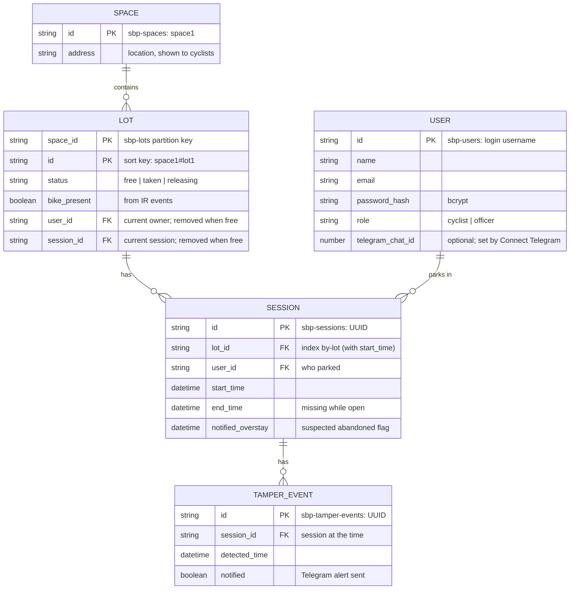

# Agreed Names and Formats

What the web app side and the AWS side have agreed on: tables and fields, who writes what, MQTT topics, payloads, and settings. Both halves are built against this file, so if anything here changes, update the file and tell the other side.

**Status: PROPOSAL (7 Nov 2026), for team review.** Items marked **[?]** need a decision.

**What changed on 7 Nov 2026:**
- **Database: back to DynamoDB** (key-value, on-demand) for cost: ~US$0 idle and no cold start. Aurora was tried and dropped.
- **Schema = the team ER diagram** (`space`, `lot`, `user`, `session`, `tamper_event`) mapped to DynamoDB tables, **plus** the fields the architecture needs: `user.password_hash`, `user.role`, `user.telegram_chat_id`, `lot.bike_present`, `lot.session_id`, `tamper_event.notified`. Space location = `space.address` (no coordinates). Sessions and tamper events keep their own `id` as in the ER diagram.
- **No open-confirmation field.** The ESP32 reports IR state; **`bike_left` confirms an unlock**. Claims get Retry / Cancel (section 3).
- Field names use the ER diagram's `snake_case`.

---

## 1. IDs and formats

| Thing | Format | Example |
|---|---|---|
| Space ID (`space.id`) | `space<N>` | `space1` |
| Lot ID (`lot.id`) | `<spaceId>#lot<N>` | `space1#lot3` |
| Lot ref (URL / QR) | `<spaceId>_lot<N>` (`#` breaks URLs) | `space1_lot3` |
| User ID (`user.id`) | the login username, lowercase | `alice` |
| Session ID, tamper event ID | UUID4 string, generated by the writer | `"3f2a..."` |
| `datetime` fields | DynamoDB has no date type: stored as an ISO 8601 string (S), UTC, seconds; sorts correctly as text | `2026-11-06T07:15:00Z` |
| `requestId` (MQTT) | UUID4 string | `"9b1f..."` |
| `expires` (in commands) | Unix epoch seconds | `1762413330` |

Times are shown to users in Singapore time (UTC+8). The **Lambda's receive time** is the official time for events (the ESP32 clock is not trusted).

---

## 2. DynamoDB tables

Created by Terraform (`infra/dynamodb.tf`). Prefix `sbp-`, region `ap-southeast-1`, on-demand billing.

### Diagram



Relational ER → key-value mapping: each entity is a table keyed by its `id`. `lot.user_id` / `lot.session_id` point at the current session, so a single `GetItem` answers "whose bike is this?" and "which session is open?". In `LOT`'s two-field key, the first `PK` is the partition key and the second the sort key. DynamoDB enforces primary keys only; `FK` fields are references kept consistent by the code (transactions + conditional writes), not by the database. `datetime` = ISO 8601 string (section 1).

### `sbp-spaces`: one item per parking space
Key: `id` (S). Few items: the web app Scans.

| Field | Type | Meaning | Written by |
|---|---|---|---|
| `id` | S | `space1` | seed |
| `address` | S | location shown to cyclists, e.g. `Bedok MRT Exit A, 1 Bedok Rd` | seed |

### `sbp-lots`: one item per lot
Key: `space_id` (S, partition) + `id` (S, sort). `Query(space_id)` = every lot in a space (availability + free count). `GetItem` needs both; both come from the lot ref / MQTT topic.

| Field | Type | Meaning | Written by |
|---|---|---|---|
| `space_id`, `id` | S | key | seed |
| `status` | S | `free` / `taken` / `releasing` (section 3) | web app, `handle_event` |
| `bike_present` | BOOL | from IR `bike_arrived` / `bike_left` | `handle_event` |
| `user_id` | S | current owner; **removed** when free | web app, `handle_event` (removes) |
| `session_id` | S | `id` of the current session; **removed** when free | web app, `handle_event` (removes) |

### `sbp-users`: one item per account
Key: `id` (S) = login username.

| Field | Type | Meaning | Written by |
|---|---|---|---|
| `id` | S | username, lowercase | web app |
| `name` | S | display name | web app |
| `email` | S | | web app |
| `password_hash` | S | bcrypt hash | web app |
| `role` | S | `cyclist` / `officer` (officers created by script, not sign-up) | web app / script |
| `telegram_chat_id` | N | set after Connect Telegram; may be missing | web app |

Lambdas only **read** `telegram_chat_id`.

### `sbp-sessions`: one item per parking (the usage archive)
Key: `id` (S, UUID). The open session of a lot is `lot.session_id`.
GSI `by-lot`: `lot_id` + `start_time` → `Query(lot_id)` = that lot's usage history (newest first with `ScanIndexForward=false`).

| Field | Type | Meaning | Written by |
|---|---|---|---|
| `id` | S | key, UUID | web app |
| `lot_id` | S | which lot | web app |
| `user_id` | S | who parked | web app |
| `start_time` | datetime | when the lot was claimed | web app |
| `end_time` | datetime | set on unlock; missing while open | web app |
| `notified_overstay` | datetime | when the overstay alert was sent = **suspected abandoned** flag | `check_overstay` |

Duration = `end_time − start_time`, computed when displayed.

### `sbp-tamper-events`: tamper log
Key: `id` (S, UUID). Dashboard Scans (small) and sorts by `detected_time`; lot and owner come from the session.

| Field | Type | Meaning | Written by |
|---|---|---|---|
| `id` | S | key, UUID | `handle_event` |
| `session_id` | S | the open session at the time (gives lot + owner) | `handle_event` |
| `detected_time` | datetime | Lambda receive time | `handle_event` |
| `notified` | BOOL | Telegram alert sent | `handle_event` |

A tamper event always belongs to a session, so it is only logged while the lot is `taken` or `releasing` (see section 7).

### Seed data
One `sbp-spaces` item per space (`id`, `address`) and one `sbp-lots` item per real lot (`status = free`, `bike_present = false`). Prototype: `space1`, 1 lot (`space1#lot1`). **[?]** address for `space1`; seed via Terraform once known.

---

## 3. Lot status and flows

```
free ──(web app: "Use this lot")──▶ taken
taken ──(web app: "Unlock" or officer Force unlock)──▶ releasing
releasing ──(handle_event: bike_left = unlock confirmed)──▶ free
```

| Change | Who | Writes (one `TransactWriteItems`) |
|---|---|---|
| free → taken | web app | lot: `status=taken`, `user_id`, `session_id`, **condition `status = free`** (fails → "Lot in use"); put session (`id`, `lot_id`, `user_id`, `start_time`) |
| taken → releasing | web app | lot: `status=releasing` (keeps `user_id`, `session_id`); session: set `end_time` |
| releasing → free | `handle_event` on `bike_left` | lot: `status=free`, remove `user_id`, `session_id` |

The ESP32 only reports IR state changes; it **never** locks or decides anything on its own. The lock is closed by hand (cable clicked in); the solenoid only opens on the cloud's `open` command.

### "Use this lot" (cyclist has parked, IR already shows a bike)
1. Claim (free → taken + session).
2. Publish `open` → the cable is released; the cyclist wraps it and clicks it in.
3. Nothing to confirm automatically (the bike was already there). The page shows **Retry** (publish `open` again) and **Cancel** (undo: lot back to `free` with condition `user_id = me`, delete the session).

### "Unlock"
1. Only `lot.user_id` may unlock (officers skip this for Force unlock).
2. taken → releasing + close the session, then publish `open`.
3. **Confirmation = `bike_left`.** The page polls the lot; `free` means done.
4. While `releasing`, the owner can tap **Unlock again** (re-publish `open`).
5. No `bike_left` within ~2 min → "Lock didn't respond, please contact staff" (officer Force unlock / manual release).

### Other IR / sensor rules
- `bike_arrived` / `bike_left` always set `bike_present`.
- `bike_left` while `taken` (bike gone without an unlock) → tamper event on that session + Telegram to the owner (recorded the same way as a tamper; see section 7).
- Lot page can show "bike detected" from `bike_present`; officer view can flag `bike_present = true` on a `free` lot (bike parked without using the system).

---

## 4. MQTT topics and payloads

| Topic | Direction | Payload |
|---|---|---|
| `space1/lot3/event` | ESP32 → cloud | `{"type": "bike_arrived"}` / `{"type": "bike_left"}` / `{"type": "tamper"}` |
| `space1/lot3/cmd` | cloud (web app) → ESP32 | `{"action": "open", "requestId": "<uuid>", "expires": <epoch s>}` |
| `space1/status` | IoT Core (Last Will) → cloud | `{"status": "offline"}` **KIV** |

- `expires` = now + 30 s. The ESP32 ignores expired commands (needs NTP time; if no NTP, it skips the check).
- `requestId` is kept for logging/debugging only (no `opened` reply needed).
- Events may include an optional `"ts"`; the Lambda ignores it and uses its own time.

**IoT Rule:** `SELECT *, topic(1) AS space, topic(2) AS lot FROM '+/+/event'` → `handle_event`.
`handle_event` builds the lot key as `space_id = space`, `id = space + "#" + lot`.

**ESP32 IoT policy:** connect as client ID `space1`; publish `space1/*/event` and `space1/status`; subscribe/receive `space1/*/cmd`.

---

## 5. What each Lambda does

**`handle_event`**
- `bike_arrived` → `bike_present = true`.
- `bike_left` → `bike_present = false`; if `releasing` → `free` (section 3); if `taken` → tamper event (`session_id = lot.session_id`) + Telegram.
- `tamper` → if the lot has a `session_id`: tamper event, Telegram to the owner (`lot.user_id`) if they have `telegram_chat_id`, set `notified`. Lot free (no session): log only to CloudWatch (section 7).

**`check_overstay`** (EventBridge Scheduler; demo every 1 min)
- Scan `sbp-lots` for `status = taken` (small table). For each: get the session `lot.session_id`; if `start_time` is older than `OVERSTAY_LIMIT_MINUTES` and there's no `notified_overstay`, Telegram to the owner and set `notified_overstay`.

---

## 6. Settings

### Terraform outputs the web app needs
| Output | Used as |
|---|---|
| `iot_data_endpoint` (e.g. `xxxx-ats.iot.ap-southeast-1.amazonaws.com`) | `IOT_DATA_ENDPOINT` |
| `table_prefix` (`sbp-`) | `TABLE_PREFIX` |
| web app IAM access key + secret (sensitive) | AWS profile `sbp-webapp` on the laptop |

### Web app IAM permissions (least privilege)
- DynamoDB: `GetItem`, `PutItem`, `UpdateItem`, `DeleteItem`, `Query`, `Scan` on the 5 tables and their indexes (transactions use these too).
- IoT: `iot:Publish` on `arn:aws:iot:ap-southeast-1:<account>:topic/space*/*/cmd` only.

### Web app `.env` (gitignored; see `webapp/.env.example`)
`BACKEND`, `AWS_PROFILE`, `AWS_REGION`, `IOT_DATA_ENDPOINT`, `TABLE_PREFIX`, `TELEGRAM_BOT_TOKEN`, `TELEGRAM_BOT_USERNAME`, `STORAGE_SECRET`

### Lambda environment variables (Terraform)
`TABLE_PREFIX`, `TELEGRAM_BOT_TOKEN` (sensitive variable), `OVERSTAY_LIMIT_MINUTES` (demo `2`, deployment e.g. `4320` = 3 days)

### Telegram
- One bot. Whoever creates it (BotFather) shares the token **privately** with both sides. Never in the repo.
- The web app uses it for `getUpdates` (Connect Telegram at sign-up). The Lambdas use it for `sendMessage`.
- **No webhook** may be set on the bot, or `getUpdates` stops working.

---

## 7. Open items [?]
1. Team sign-off on this proposal (redraw the ER diagram from section 2).
2. Address for `space1`, then seed it.
3. "Nearest spaces": with only `address`, the cyclist page lists spaces by address; sorting by distance would need coordinates or geocoding.
4. `handle_offline` (KIV).
5. Tamper events need a session, so **tamper on a free lot is not stored** (CloudWatch log only).
6. No `type` on tamper events: a **suspected theft** (bike left while `taken`) looks the same as a vibration tamper on the dashboard.
