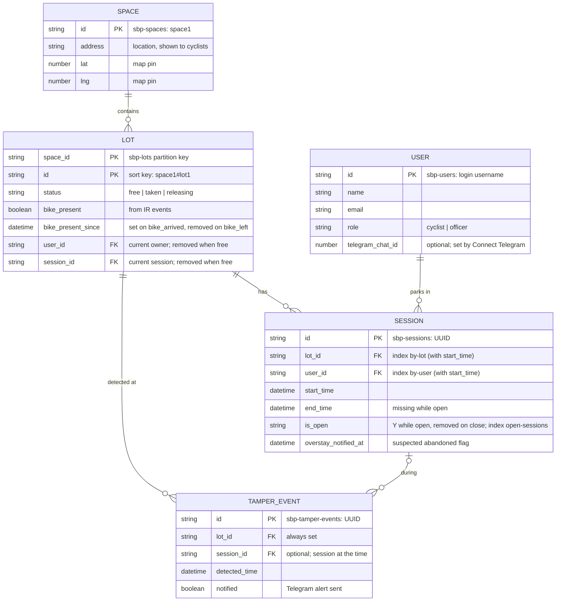

# Agreed Names and Formats

What the web app side and the AWS side have agreed on: tables and fields, who writes what, MQTT topics, payloads, and settings. Both halves are built against this file, so if anything here changes, update the file and tell the other side.

**Status: updated 10 Nov 2026.** Items marked **[?]** need a decision.

**Schema review (10 Nov, AWS side):**
- **`session.is_open`** (`"Y"` while open, **removed** on close) + sparse GSI **`open-sessions`** (`is_open` + `start_time`): open sessions / abandoned bikes without scanning the whole table. `check_overstay` now queries this index.
- **GSI `by-user`** on sessions (`user_id` + `start_time`): "my parking history".
- **`notified_overstay` → `overstay_notified_at`** (still a datetime; name now says what it holds).
- **`lot.bike_present_since`** (datetime): when IR last saw a bike arrive; removed on `bike_left`. Lets the officer view flag **bikes parked without using the system**.
- **Officer view derived flags** (computed when the page loads, nothing stored): *stuck releasing* and *unregistered bike* (section 3).
- **Lambdas write conditionally** on the status they read (no false theft alerts from a race with Unlock) and log **one JSON line per event** for measured results (section 5).
- Lambda logic diagrams: **`docs/cloud-logic.md`**.
- **Login moves to Amazon Cognito.** `user.password` is **removed**: Cognito stores the password; `sbp-users` keeps the profile, `role` and `telegram_chat_id`. Cognito username = `user.id`. Self-service **forgot password** by emailed code for both roles. See "Login (Cognito)" in section 2.

**What changed on 10 Nov 2026:**
- **Web app = FastAPI + HTML pages** (Jinja2, Tailwind, HTMX, Leaflet), port 8000. NiceGUI is dropped.
- **`space.lat` / `space.lng`** added (map pins).
- **`tamper_event.lot_id`** added (always set); `session_id` is now optional, so **tamper on a free lot is stored** too.
- ~~`user.password_hash` → `user.password`, plaintext~~ (superseded the same day by Cognito, above).
- **Starting data** (spaces, lots, officer account) is loaded by **`webapp/load_starting_data.py`**, not Terraform (section 2).
- Web app `.env`: `STORAGE_SECRET` → `SESSION_SECRET`.

**Earlier (7 Nov):** DynamoDB (on-demand); schema = the team ER diagram with `snake_case` fields; no `opened` confirmation (IR `bike_left` confirms an unlock; claims get Retry / Cancel).

---

## 1. IDs and formats

| Thing | Format | Example |
|---|---|---|
| Space ID (`space.id`) | `space<N>` | `space1` |
| Lot ID (`lot.id`) | `<spaceId>#lot<N>` | `space1#lot3` |
| Lot ref (URL / QR) | `<spaceId>_lot<N>` (`#` breaks URLs) | `space1_lot3` |
| User ID (`user.id`) | the login username, lowercase | `alice` |
| Session ID, tamper event ID | UUID4 string, generated by the writer | `"3f2a..."` |
| `datetime` fields | DynamoDB has no date type: stored as an ISO 8601 string (S), UTC, seconds; sorts correctly as text | `2026-11-06T07:15:00Z` |
| `lat`, `lng` | decimal degrees (N) | `1.3240`, `103.9300` |
| `requestId` (MQTT) | UUID4 string | `"9b1f..."` |
| `expires` (in commands) | Unix epoch seconds | `1762413330` |

Times are shown to users in Singapore time (UTC+8). The **Lambda's receive time** is the official time for events (the ESP32 clock is not trusted).

---

## 2. DynamoDB tables

Created by Terraform (`infra/dynamodb.tf`). Prefix `sbp-`, region `ap-southeast-1`, on-demand billing. Terraform declares key fields only; all other fields are schemaless and need no Terraform change.

### Diagram



Relational ER → key-value mapping: each entity is a table keyed by its `id`. `lot.user_id` / `lot.session_id` point at the current session, so a single `GetItem` answers "whose bike is this?" and "which session is open?". In `LOT`'s two-field key, the first `PK` is the partition key and the second the sort key. DynamoDB enforces primary keys only; `FK` fields are references kept consistent by the code (transactions + conditional writes), not by the database. `datetime` = ISO 8601 string (section 1).

### `sbp-spaces`: one item per parking space
Key: `id` (S). Few items: the web app Scans.

| Field | Type | Meaning | Written by |
|---|---|---|---|
| `id` | S | `space1` | starting-data script |
| `address` | S | location shown to cyclists, e.g. `Bedok MRT Exit A, 1 Bedok Rd` | starting-data script |
| `lat` | N | latitude, for the map pin and "Get directions" | starting-data script |
| `lng` | N | longitude | starting-data script |

### `sbp-lots`: one item per lot
Key: `space_id` (S, partition) + `id` (S, sort). `Query(space_id)` = every lot in a space (lot grid + free count; no stored counter). `GetItem` needs both; both come from the lot ref / MQTT topic.

| Field | Type | Meaning | Written by |
|---|---|---|---|
| `space_id`, `id` | S | key | starting-data script |
| `status` | S | `free` / `taken` / `releasing` (section 3) | web app, `handle_event` |
| `bike_present` | BOOL | from IR `bike_arrived` / `bike_left` | `handle_event` |
| `bike_present_since` | datetime | when the current bike arrived (IR); **removed** on `bike_left` | `handle_event` |
| `user_id` | S | current owner; **removed** when free | web app, `handle_event` (removes) |
| `session_id` | S | `id` of the current session; **removed** when free | web app, `handle_event` (removes) |

### `sbp-users`: one item per account
Key: `id` (S) = login username.

| Field | Type | Meaning | Written by |
|---|---|---|---|
| `id` | S | username, lowercase | web app |
| `name` | S | display name | web app |
| `email` | S | | web app |
| `role` | S | `cyclist` / `officer` (officers created by the starting-data script, not sign-up) | web app / starting-data script |
| `telegram_chat_id` | N | set after Connect Telegram; may be missing | web app |

Lambdas only **read** `telegram_chat_id`. No password here: Cognito holds it.

### Login (Cognito)
User pool `sbp-users` (Terraform, `infra/cognito.tf`) holds **usernames, passwords and the email used for password resets**. Cognito username = `user.id` (lowercase, case-insensitive). Public app client (no secret), flow `USER_PASSWORD_AUTH`.

The web app keeps its **own** `/signup`, `/login` and `/forgot-password` pages and calls Cognito server-side with boto3 (`cognito-idp`). No Cognito hosted login page (its callback must be HTTPS except on `localhost`; demo phones use `http://<laptop-ip>:8000`).

**Role-based access:** Cognito answers *who* the user is; `sbp-users.role` answers *what they may do*. `cyclist` = self sign-up, cyclist pages. `officer` = government staff, created only by the starting-data script, officer dashboard + Force unlock (checked on every officer page load). Role is not stored in Cognito.

| Action | Web app calls |
|---|---|
| Sign up (cyclists only) | `sign_up(ClientId, Username=id, Password, UserAttributes=[email])` → `admin_confirm_sign_up(UserPoolId, Username)` → `admin_update_user_attributes(UserPoolId, Username, [email_verified = "true"])` → put `sbp-users` item (`id`, `name`, `email`, `role = cyclist`). One step for the user, no email sent |
| Log in (both roles) | `initiate_auth(ClientId, AuthFlow="USER_PASSWORD_AUTH", AuthParameters={USERNAME, PASSWORD})`; success → read `sbp-users` item → store `username`, `role` in the signed session cookie |
| Wrong username or password | `NotAuthorizedException` (same error for both) |
| Forgot password (both roles) | page 1: `forgot_password(ClientId, Username)` → Cognito emails a 6-digit code. Page 2: `confirm_forgot_password(ClientId, Username, ConfirmationCode, Password)` → back to login. Errors: `CodeMismatchException`, `ExpiredCodeException`, `LimitExceededException` |
| Officer account | starting-data script: `admin_create_user` (`MessageAction="SUPPRESS"`, attributes `email` + `email_verified = "true"`) + `admin_set_user_password(Permanent=True)`, then `sbp-users` item with `role = officer` |
| Fallback reset (no email access, lost phone) | officer verifies the person, then `admin_set_user_password` (AWS console: Cognito → user → Reset password also works) |

Password rule: at least 8 characters. Tokens returned by `initiate_auth` aren't needed after login: the session cookie is enough.

**Email notes:** sent by Cognito's built-in sender (`no-reply@verificationemail.com`, ~50/day, free); it can land in spam. The sign-up email is marked verified without a code (PoC shortcut, keeps sign-up one step): a mistyped email means reset codes go to the wrong address. Production: verify the email with a code at sign-up.

### `sbp-sessions`: one item per parking (the usage archive)
Key: `id` (S, UUID). The open session of a lot is `lot.session_id`.

| Index | Keys | Query |
|---|---|---|
| `by-lot` | `lot_id` + `start_time` | that lot's usage history (newest first with `ScanIndexForward=false`) |
| `by-user` | `user_id` + `start_time` | a cyclist's "my parking history" |
| `open-sessions` | `is_open` + `start_time` | **sparse**: `Query(is_open = "Y")` = only open sessions (abandoned-bike check, officer view) |

| Field | Type | Meaning | Written by |
|---|---|---|---|
| `id` | S | key, UUID | web app |
| `lot_id` | S | which lot | web app |
| `user_id` | S | who parked | web app |
| `start_time` | datetime | when the lot was claimed | web app |
| `end_time` | datetime | set on unlock; missing while open | web app |
| `is_open` | S | `"Y"` while open; **removed** (not set to "N") when the session closes | web app |
| `overstay_notified_at` | datetime | when the overstay alert was sent = **suspected abandoned** flag | `check_overstay` |

Duration = `end_time − start_time`, computed when displayed.

### `sbp-tamper-events`: tamper log
Key: `id` (S, UUID). Console Scans (small) and sorts by `detected_time`, newest first. Location comes from `lot_id`; owner (if any) from the session.

| Field | Type | Meaning | Written by |
|---|---|---|---|
| `id` | S | key, UUID | `handle_event` |
| `lot_id` | S | where it happened, e.g. `space1#lot3`; **always set** | `handle_event` |
| `session_id` | S | the open session at the time; **missing** if the lot was free | `handle_event` |
| `detected_time` | datetime | Lambda receive time | `handle_event` |
| `notified` | BOOL | Telegram alert sent | `handle_event` |

### Starting data
Loaded by **`webapp/load_starting_data.py`** (not Terraform). It only **creates rows that don't exist yet** and **never overwrites** an existing row (conditional put: `attribute_not_exists`), so it is safe to re-run against live data.
- One `sbp-spaces` item per space (`id`, `address`, `lat`, `lng`).
- One `sbp-lots` item per real lot (`status = free`, `bike_present = false`). Prototype: `space1`, 1 lot (`space1#lot1`).
- One officer account: Cognito user (`admin_create_user` + `admin_set_user_password`) + `sbp-users` item (`role = officer`). Skipped if it already exists.

**[?]** Real address and coordinates for `space1`.

---

## 3. Lot status and flows

```
free ──(web app: "Use this lot")──▶ taken
taken ──(web app: "Unlock" or officer Force unlock)──▶ releasing
releasing ──(handle_event: bike_left = unlock confirmed)──▶ free
```

| Change | Who | Writes (one `TransactWriteItems`) |
|---|---|---|
| free → taken | web app | lot: `status=taken`, `user_id`, `session_id`, **condition `status = free`** (fails → "Lot in use"); put session (`id`, `lot_id`, `user_id`, `start_time`, `is_open = "Y"`) |
| taken → releasing | web app | lot: `status=releasing` (keeps `user_id`, `session_id`); session: set `end_time`, **remove `is_open`** |
| releasing → free | `handle_event` on `bike_left` | lot: `status=free`, remove `user_id`, `session_id` |

The ESP32 only reports IR state changes; it **never** locks or decides anything on its own. The lock is closed by hand (cable clicked in); the solenoid only opens on the cloud's `open` command.

### "Use this lot" (cyclist has parked, IR already shows a bike)
1. Claim (free → taken + session).
2. Publish `open` → the cable is released; the cyclist wraps it and clicks it in.
3. Nothing to confirm automatically (the bike was already there). The page shows **Retry** (publish `open` again) and **Cancel** (undo: lot back to `free` with condition `user_id = me`, delete the session).

### "Unlock"
1. Only `lot.user_id` may unlock (officers skip this for Force unlock).
2. taken → releasing + close the session, then publish `open`.
3. **Confirmation = `bike_left`.** The page polls the lot; `free` means done.
4. While `releasing`, the owner can tap **Unlock again** (re-publish `open`).
5. No `bike_left` within ~2 min → "Lock didn't respond, please contact staff" (officer Force unlock / manual release).

### Other IR / sensor rules
- `bike_arrived` → `bike_present = true`, `bike_present_since = now` (kept if already set). `bike_left` → `bike_present = false`, remove `bike_present_since`.
- `bike_left` while `taken` (bike gone without an unlock) → **suspected theft**: tamper event on that lot + session, Telegram to the owner (recorded the same way as a tamper; see section 7).
- Tamper while `releasing` → stored, **no alert** (the owner is unlocking).
- IR flicker (brief `bike_left` then `bike_arrived`) is handled by the **ESP32's debounce**, not the cloud.

### Web app rules that protect the flow
- **Claim only when `bike_present = true`** (nobody can claim an empty lot remotely).
- The web app never sets a lot to `free` from `releasing`; only `bike_left` does.

### Officer view: derived flags (computed when the page loads; nothing stored)
| Flag | Rule | Why |
|---|---|---|
| **Suspected abandoned** | session has `overstay_notified_at` (set by `check_overstay`) | owner parked too long |
| **Stuck releasing** | lot `status = releasing` and its session's `end_time` older than `RELEASE_TIMEOUT_MINUTES` (demo `2`) | unlock sent but the bike never left: lock may have failed, or the bike was left behind after the session closed |
| **Unregistered bike** | lot `status = free`, `bike_present = true`, `bike_present_since` older than `UNREGISTERED_LIMIT_MINUTES` (demo `2`, deployment e.g. `1440`) | bike parked without using the system (the classic abandoned bike) |

Thresholds are web app settings (`.env`).

---

## 4. MQTT topics and payloads

| Topic | Direction | Payload |
|---|---|---|
| `space1/lot3/event` | ESP32 → cloud | `{"type": "bike_arrived"}` / `{"type": "bike_left"}` / `{"type": "tamper"}` |
| `space1/lot3/cmd` | cloud (web app) → ESP32 | `{"action": "open", "requestId": "<uuid>", "expires": <epoch s>}` |
| `space1/status` | IoT Core (Last Will) → cloud | `{"status": "offline"}` **KIV** |

- `expires` = now + 30 s. The ESP32 ignores expired commands (needs NTP time; if no NTP, it skips the check).
- `requestId` is kept for logging/debugging only (no `opened` reply needed).
- Events may include an optional `"ts"` (epoch ms, NTP time). The Lambda's own time is still the official time; `ts` is only used to measure latency in logs.

**IoT Rule:** `SELECT *, topic(1) AS space, topic(2) AS lot FROM '+/+/event'` → `handle_event`.
`handle_event` builds the lot key as `space_id = space`, `id = space + "#" + lot`.

**ESP32 IoT policy:** connect as client ID `space1`; publish `space1/*/event` and `space1/status`; subscribe/receive `space1/*/cmd`.

---

## 5. What each Lambda does

Diagrams: **`docs/cloud-logic.md`**.

**`handle_event`**
- `bike_arrived` → `bike_present = true`, `bike_present_since = now` (if not set).
- `bike_left` → `bike_present = false`, remove `bike_present_since`; then by status: `releasing` → `free` (remove `user_id`, `session_id`); `taken` → tamper event (`lot_id`, `session_id`) + Telegram (suspected theft); `free` → nothing more.
- `tamper` → always write a tamper event with `lot_id`. `taken`: add `session_id`, Telegram to the owner (`lot.user_id`) if they have `telegram_chat_id`, set `notified`. `releasing`: add `session_id`, no alert. `free`: no `session_id`, no alert. (`notified = false` when no alert sent.)
- Unknown lot or bad payload → log and ignore (writes use `attribute_exists`, so a wrong topic never creates a lot).
- **Conditional writes:** each lot update includes `status = <status just read>`. If it fails (the web app changed the lot meanwhile), re-read and decide again (max 3 tries).
- Telegram failure never blocks the DB write. DynamoDB errors raise → Lambda retries (up to 2); writes are safe to repeat (worst case: a duplicate tamper row).

**`check_overstay`** (EventBridge Scheduler; demo every 1 min, deployment every 15 min)
- Query `open-sessions` (`is_open = "Y"`, `start_time` < now − `OVERSTAY_LIMIT_MINUTES`, all pages). For each: set `overstay_notified_at = now` **only if not set** (marks suspected abandoned even without Telegram; overlapping runs can't double-alert), then Telegram the owner if they have `telegram_chat_id`.

**Telegram messages** include the space `address`, lot number and time in SGT (UTC+8). Both Lambdas need `GetItem` on `sbp-spaces` and `sbp-users`.

**Logging (measured results):** one JSON line per handled event, e.g.
`{"fn": "handle_event", "type": "tamper", "lot_id": "space1#lot1", "status": "taken", "action": "alert", "notified": true, "received_at": "...", "device_ts": "..." , "latency_ms": 420}`.
`latency_ms` = Lambda receive time − ESP32 `ts` (only if the ESP32 sends `ts` and has NTP time). CloudWatch Logs Insights can then give event counts, alert success rate and latency for the slides.

---

## 6. Settings

### Terraform outputs the web app needs
| Output | Used as |
|---|---|
| `iot_data_endpoint` (e.g. `xxxx-ats.iot.ap-southeast-1.amazonaws.com`) | `IOT_DATA_ENDPOINT` |
| `table_prefix` (`sbp-`) | `TABLE_PREFIX` |
| `cognito_user_pool_id` | `COGNITO_USER_POOL_ID` |
| `cognito_client_id` | `COGNITO_CLIENT_ID` |
| web app IAM access key + secret (sensitive) | AWS profile `sbp-webapp` on the laptop |

### Web app IAM permissions (least privilege)
- DynamoDB: `GetItem`, `PutItem`, `UpdateItem`, `DeleteItem`, `Query`, `Scan` on the 5 tables and their indexes (transactions use these too).
- IoT: `iot:Publish` on `arn:aws:iot:ap-southeast-1:<account>:topic/space*/*/cmd` only.
- Cognito (user pool only): `AdminConfirmSignUp`, `AdminUpdateUserAttributes`, `AdminCreateUser`, `AdminSetUserPassword`, `AdminGetUser`. (`SignUp`, `InitiateAuth`, `ForgotPassword`, `ConfirmForgotPassword` need no IAM permission.)

### Web app `.env` (gitignored; see `webapp/.env.example`)
`BACKEND`, `SESSION_SECRET`, `AWS_PROFILE`, `AWS_REGION`, `IOT_DATA_ENDPOINT`, `TABLE_PREFIX`, `COGNITO_USER_POOL_ID`, `COGNITO_CLIENT_ID`, `TELEGRAM_BOT_TOKEN`, `TELEGRAM_BOT_USERNAME`, `RELEASE_TIMEOUT_MINUTES` (demo `2`), `UNREGISTERED_LIMIT_MINUTES` (demo `2`, deployment e.g. `1440`)

### Lambda environment variables (Terraform)
`TABLE_PREFIX`, `TELEGRAM_BOT_TOKEN` (sensitive variable), `OVERSTAY_LIMIT_MINUTES` (demo `2`, deployment e.g. `4320` = 3 days)

### Telegram
- One bot. Whoever creates it (BotFather) shares the token **privately** with both sides. Never in the repo.
- The web app uses it for `getUpdates` (Connect Telegram at sign-up). The Lambdas use it for `sendMessage`.
- **No webhook** may be set on the bot, or `getUpdates` stops working.

---

## 7. Open items [?]
1. Real address and `lat`/`lng` for `space1` (starting-data script).
2. `handle_offline` (KIV).
3. No `type` on tamper events: a **suspected theft** (bike left while `taken`) looks the same as a vibration tamper on the dashboard.

Closed on 10 Nov: "nearest spaces" needs coordinates → `lat`/`lng` added; tamper on a free lot not stored → `lot_id` added, now stored.
