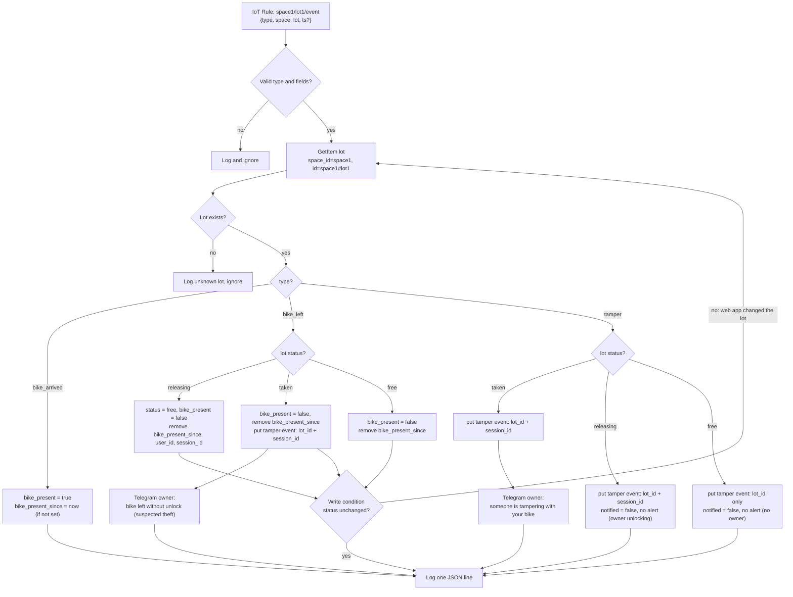
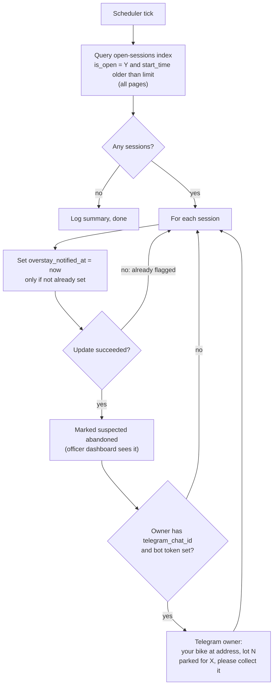
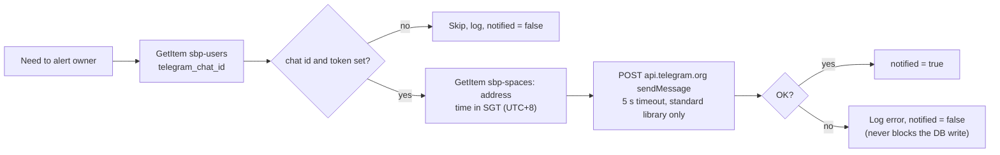
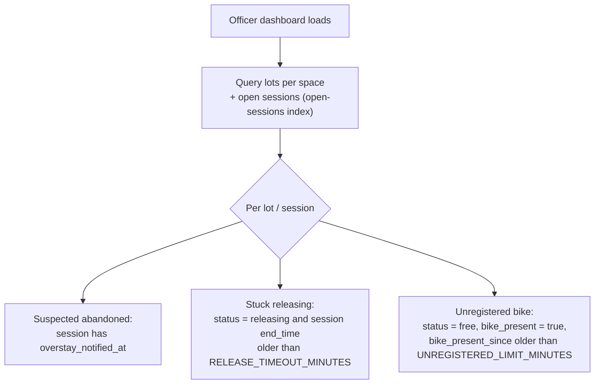
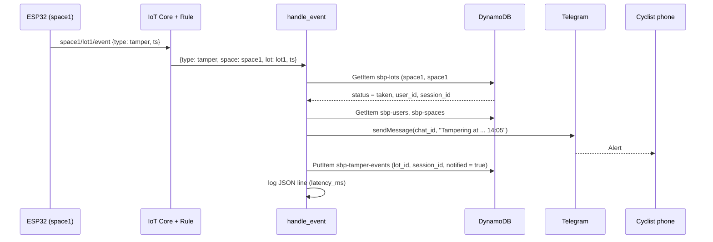
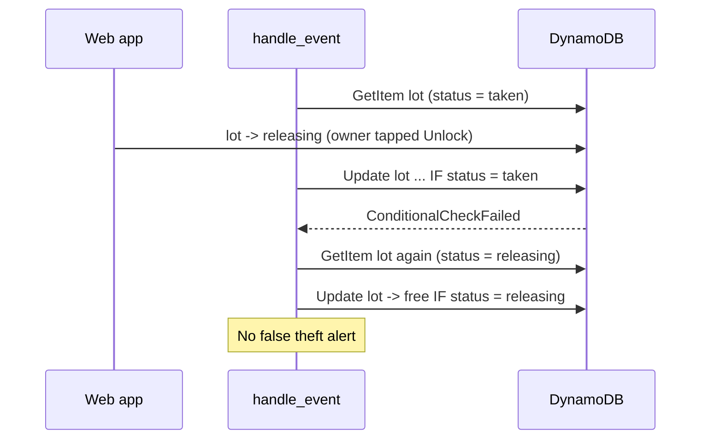

# Cloud logic (Lambdas)

How `handle_event` and `check_overstay` behave. **Status: plan, agreed before building (10 Nov 2026).** Field names and payloads come from [`agreed-names-and-formats.md`](agreed-names-and-formats.md); if the two disagree, that file wins.

Decisions baked in:
- Tamper while the lot is `releasing` → stored, **no alert** (the owner is unlocking).
- Every lot write is **conditional on the status just read**; on conflict, re-read and decide again (max 3 tries).
- Telegram failures never block a database write. DynamoDB errors raise → Lambda retries (up to 2).
- One JSON log line per event (measured results).
- Officer flags *stuck releasing* and *unregistered bike* are computed by the web app when the page loads (no Lambda involved).

---

## 1. Lot status

```mermaid
stateDiagram-v2
    [*] --> free
    free --> taken: web app - Use this lot (needs bike_present; claim + session, is_open=Y)
    taken --> free: web app - Cancel (delete session)
    taken --> releasing: web app - Unlock / officer Force unlock (end_time, remove is_open)
    releasing --> free: handle_event - bike_left (unlock confirmed)
    releasing --> releasing: owner taps Unlock again (re-send open)
```



## 2. `handle_event` (every ESP32 event, via IoT Rule)



Conditional writes: lot updates carry `ConditionExpression: status = :read_status AND attribute_exists(id)`. A failed condition means the web app changed the lot between our read and write (e.g. the owner just tapped Unlock), so we re-read and take the right branch. This prevents a false theft alert. Max 3 tries, then log and stop.

## 3. `check_overstay` (EventBridge Scheduler: every 1 min demo, 15 min deployment)



## 4. Telegram alert (helper in both Lambdas)



## 5. Officer view flags (web app, computed on page load)



## 6. Example: tamper on a parked bike



## 7. Example: unlock racing with bike_left (why writes are conditional)



## 8. Logging (measured results)

One JSON line per handled event or overstay run, e.g.

```json
{"fn": "handle_event", "type": "tamper", "lot_id": "space1#lot1", "status": "taken",
 "action": "alert", "notified": true, "received_at": "2026-11-10T06:05:01Z",
 "device_ts": 1762754700580, "latency_ms": 420}
```

CloudWatch Logs Insights queries over these give event counts, alert success rate, and ESP32-to-cloud latency (when the ESP32 sends `ts`).

## 9. Testing plan

- **Unit tests** (`lambdas/tests/`, pytest + moto, dev-only, not deployed): one test per branch of diagrams 2 and 3, plus the race in diagram 7. Telegram is faked.
- **Test data:** `infra/test_data.sh` puts `space1`, `space1#lot1` and a test user (create-only), plus a reset. Replaced later by `webapp/load_starting_data.py`.
- **End-to-end on AWS:** `aws iot-data publish` events, simulate claim/unlock with CLI writes, check DynamoDB, logs and Telegram.

## Where the code is (built 12 Nov)

| File | Contents |
|---|---|
| `lambdas/handle_event/handler.py` | diagram 2 + the race retry (diagram 7) |
| `lambdas/check_overstay/handler.py` | diagram 3 |
| `lambdas/shared/sbp_common.py` | time, JSON logging, DynamoDB tables, Telegram helper (diagram 4); zipped into both Lambdas by `infra/lambdas.tf` |
| `lambdas/tests/` | 22 unit tests (pytest + moto) |
| `infra/test_data.sh` | test data + web-app stand-ins (`load`, `claim`, `unlock`, `show`, `reset`) |

Run the unit tests (from `lambdas/`): `python -m venv .venv`, install `requirements-dev.txt`, then `python -m pytest tests -q`. See `infra/README.md` for the end-to-end test on AWS.
